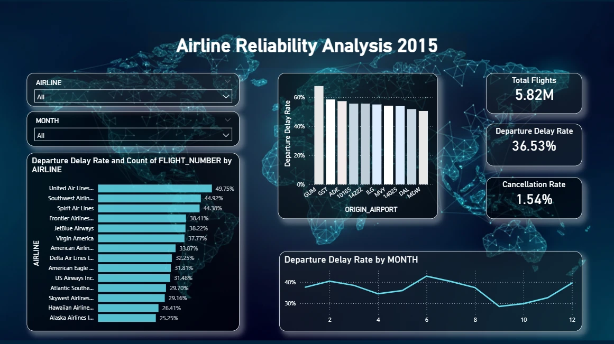
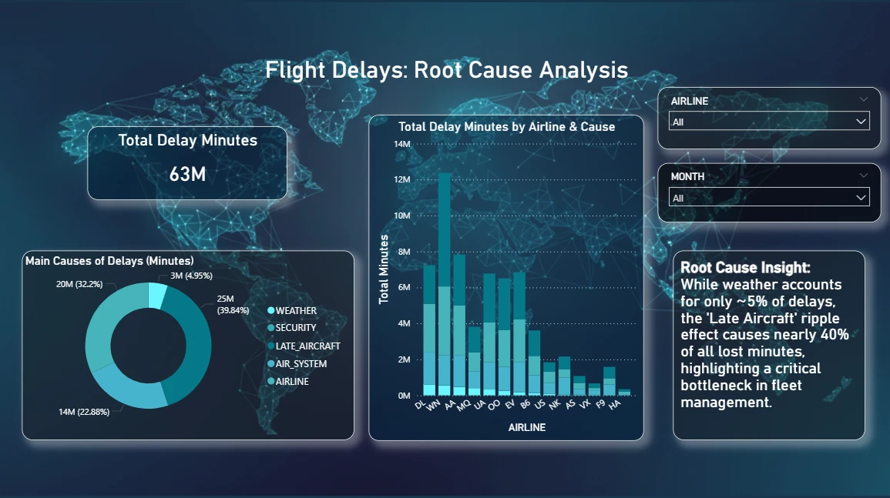

# Airline Reliability Analysis 2015

Power BI dashboard analyzing U.S. flight data from 2015: departure delays, cancellations, airlines, airports, monthly trends and the root causes of delays.

## Page 1: Airline Reliability Analysis

**Key metrics**

- **Total flights:** 5.82M
- **Departure delay rate:** 36.53%
- **Cancellation rate:** 1.54%

**What's on this page**

- Departure delay rate by airline
- Origin airports with the highest departure delay rate
- Departure delay rate by month

## Page 2: Flight Delays Root Cause Analysis

**Key metrics**

- **Total delay minutes:** 63M

**What's on this page**

- Main causes of delays in minutes: weather, security, late aircraft, air system and airline
- Total delay minutes by airline and cause

**Root cause insight:** Weather accounts for only about 5% of delay minutes, while the "late aircraft" ripple effect causes nearly 40% of all lost minutes. This points to a critical bottleneck in fleet management.

## Filters

Both pages can be filtered by airline and by month.

## How to open

Download `flight-data-analysis.pbix` (about 128MB, stored with Git LFS) and open it with Power BI Desktop.
